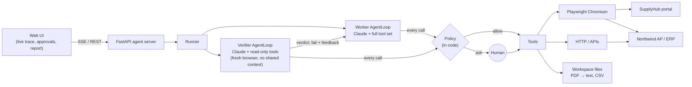

# Autonomous AI Task Worker

An AI worker that takes a natural-language goal and completes it end-to-end by operating
company applications in a real browser. Along the way it plans, observes each result, recovers
from failures, asks the user when it cannot safely continue, and has the outcome checked by an
independent verifier before reporting success.

> *"Find the latest invoice from Acme Supplies, extract the amount and due date, enter it into
> our internal system, and tell me once it is done."*

For that task the worker:
1. Logs into a vendor portal.
2. Filters to the right supplier and picks the latest **invoice**. The newer credit note is ignored.
3. Downloads the PDF and reads `TOTAL DUE USD 5,322.11` and `Due Date: October 31, 2026`.
4. Logs into the internal AP system and dismisses a pop-up.
5. Re-authenticates after a session expiry and retries after a 503.
6. Converts dates to `YYYY-MM-DD`, saves the bill, re-opens it to check every field, and captures screenshots.

Then a separate verifier agent logs in with read-only access, checks the source document and
the saved record itself, and passes or fails the run. A failed run is sent back to the worker to fix.

---

## Quick start

```bash
python3 -m venv .venv && source .venv/bin/activate
pip install -r requirements.txt
python -m playwright install chromium
cp .env.example .env              # then paste a key (see "Model provider" below)
python run.py                     # starts everything in one process
```

### Model provider

| Provider | Cost | Set in `.env` |
|---|---|---|
| **Google Gemini** (default) | Free tier (Google AI Studio) | `LLM_PROVIDER=gemini`, `GEMINI_API_KEY=` from https://aistudio.google.com/apikey |
| Anthropic Claude | Paid | `LLM_PROVIDER=anthropic`, `ANTHROPIC_API_KEY=sk-ant-...` |
| Any OpenAI-compatible API (OpenRouter, Ollama, vLLM) | Varies | `LLM_PROVIDER=openai_compat`, `LLM_BASE_URL`, `LLM_API_KEY`, `WORKER_MODEL` |

On Gemini's free tier, requests are spaced to stay under the per-minute limit (`LLM_RPM`, default 5).
One task with verification takes roughly 20–40 model calls, so the daily free quota covers a few full runs per day.

| URL | What |
|---|---|
| http://localhost:8000 | **Agent UI**: give tasks, watch the live trace, answer questions and approvals |
| http://localhost:8101 | *SupplyHub*: simulated vendor billing portal (`ap@northwind.example` / `portal-pass-2026`) |
| http://localhost:8102 | *Northwind AP*: simulated internal AP system / ERP (`jdoe` / `erp-pass-2026`) |

In the UI, pick an example task (or write your own) and press **Run task**. Useful toggles:
- **Chaos mode** injects real-world failures (pop-up overlay, session expiry, HTTP 503, PDF service error).
- **Supervised** autonomy requires approval for every form submission.
- `HEADLESS=false` in `.env` opens a visible Chromium so you can watch it work (good for recording).

### Tests and evaluation

```bash
pytest -q                          # 24 offline tests: sim apps, policy, browser tools, full loop with a scripted model
python scripts/run_scenarios.py    # live evaluation with the real model; checks *actual system state*
python scripts/run_scenarios.py canonical chaos   # a subset
```

The scenario harness runs each task through the full worker → verifier pipeline. It answers
questions and approvals with scripted replies, then checks the ERP's real data against ground
truth, not the agent's own claims:

| Scenario | What it tests |
|---|---|
| `canonical` | The example task: right document, exact values, one bill, verified |
| `chaos` | Same task with an overlay, session expiry, 503 on submit, and a PDF service error injected |
| `ambiguous` | "latest invoice from **Acme**". Two vendors match, so it must ask, then complete |
| `missing_vendor` | The vendor exists on the portal but not in the ERP. It must not invent master data |
| `overdue_report` | A different kind of task (read + compute + write a CSV). The ERP must stay untouched |
| `approve` / `approve_denied` | A financial action is gated by human approval and honoured both ways |

### Live results so far

| Scenario | Model(s) | Result | Notes |
|---|---|---|---|
| `canonical` | Gemini free tier: 3.7 → 3.6 → 3.1-flash-lite → 3.5-flash-lite (automatic quota fallbacks) | **PASS: verified** | INV-20761 found (the newer credit note correctly skipped), $5,322.11 and 2026-10-31 extracted from the PDF, BILL-1009 created and checked through the API. The verifier passed 3 of 3 checks, and ground truth confirmed exactly one correct bill. 56 model calls, about 14 minutes, $0 |

That run switched models four times mid-task as free daily quotas ran out (20 requests per model
per day on this key) and as models returned 503 "high demand" errors. It finished without
losing progress.

---

## Architecture



```
run.py                  one process: 2 simulated apps + agent server
environment.json        the "company directory": apps, URLs, docs, secret names  ← swap this to retarget
worker/
  loop.py               AgentLoop: think → act → observe → adapt (shared by worker and verifier)
  runner.py             orchestration: work → verify → repair rounds → report
  policy.py             approval / deny guardrails enforced outside the model
  context.py            per-run state: memory, plan, human-in-the-loop futures, browser
  llm.py                Claude client: retries, refusal fallback, token/cost accounting
  llm_openai.py         OpenAI-compatible client (Gemini free tier, OpenRouter, Ollama): format translation, rate limiting
  prompts.py            task-agnostic worker and verifier prompts
  tools/
    browser.py          Playwright tools + page observation (status, overlays, downloads)
    snapshot.js         DOM → compact text with element refs [e12]
    http.py files.py    API calls with secret placeholders, sandboxed workspace (PDF → text)
    control.py          update_plan, remember, ask_user, request_approval, finish, submit_verdict
server/                 FastAPI + vanilla-JS UI (no build step)
simenv/                 the simulated company: vendor portal, ERP (UI + REST), PDFs, chaos
scripts/run_scenarios.py  live evaluation against ground truth
tests/                  offline tests with a scripted fake model
```

### The loop

Each turn the model gets the conversation so far. It may think (adaptive thinking), write a
note, and call one or more tools. For every tool call the harness:

1. Validates the input.
2. Asks the tool to **assess** what the call would do (read, input, auth, submit, financial, destructive...).
3. Has the **policy** decide: allow, ask the human, or deny.
4. Runs the tool with a timeout, retrying once on transient errors.
5. Returns the observation. Browser actions always return the new page state.
6. Emits events to the UI.

After each turn, the harness can append guidance as text, never by editing history:
- Stuck detection (the same failing action 3×, or 5 errors in a row).
- A turn-budget warning.
- A nudge when the model stops without calling `finish`.

The loop ends when the agent calls `finish` (or `submit_verdict`), or when the turn budget runs out.

---

## Key design decisions (and why)

**1. A browser driven through a DOM snapshot with element refs, not pixel-level computer use.**
The model sees something like this:

```
[ALERT] Your session has expired. Please sign in again.
[e1] textbox "Username" type=text value=""
[e3] button "Log in"
```

It then acts on refs (`browser_click e3`). This is far more reliable and cheaper than coordinate
clicking, and it works on any HTML app without per-site code. Every action returns the
*resulting* state, including the URL, HTTP status, alerts, new downloads, and full-screen
overlays, so "observe the result" is built into the tool rather than left to the prompt. A
screenshot is taken after each action for the UI timeline (not sent to the model, to save tokens).

**2. Verification is a separate agent with fresh context and read-only access.**
Self-checking is biased: the agent that made a mistake tends to confirm it. The verifier:
- gets only the task and the worker's *claims*, not its reasoning;
- logs in with its own browser session, which proves the data persisted server-side;
- re-reads the source document and checks the destination record field by field;
- returns structured checks.

A failed verdict sends concrete feedback back into the **same** worker conversation, so it keeps
its context, for up to 2 repair rounds. The worker is also told to self-verify. That layer is
cheap, but the independent check is what the final status relies on (`verified`,
`completed_unverified`, or `verification_failed`).

**3. Safety gates live in code, not only in the prompt.**
The model is asked to request approval before consequential actions, but the harness doesn't
rely on that. Every call is classified from what it would actually do: the clicked button's
text, its form's method and action, the HTTP method, and the URL. Then:
- **Financial** actions (approve, pay, transfer) and **destructive** actions (delete, void) always
  pause for a human in `autonomous` mode.
- `supervised` mode also gates every submit and external write.
- Login forms are exempt.
- Navigation outside the apps in `environment.json` is denied.
- The verifier's policy is read-only: it can log in and look, never change anything.

One user approval covers one action, so the agent can't approve once and then go further.

**4. Secrets never enter the model's context.**
The model types `browser_type_secret(ref, "erp.password")` or uses
`{{secret:erp.api_token}}` placeholders in API headers. The tool substitutes the real value,
and snapshots mask secret-filled fields. A test asserts that the API token never appears in
anything sent to the model.

**5. One generic engine, with company-specific knowledge as data.**
The same `AgentLoop` runs the worker and the verifier; only the prompt, tools and policy
differ. Prompts contain no task-specific steps. The apps, their URLs, a one-paragraph
description of each, and secret *names* live in `environment.json`. A different task needs no
code change (see the scenario list). Pointing the worker at a different company's tools means
editing that JSON. For unrelated web apps, nothing else changes, because the snapshot and
tools are generic.

**6. Failure handling in layers.**

| Layer | Handles |
|---|---|
| SDK + `llm.py` | API 429 / 5xx / network: SDK retries, then an outer backoff, then a clean run failure. Refusals use server-side fallback |
| Tool | Transient browser and network errors: one automatic retry |
| Tool messages | Errors explained in actionable terms ("an overlay is covering it, dismiss it first", "refs change after every page update", the HTTP status, validation messages left on the page) |
| Model | Diagnoses and adapts: re-login, fix field formats, retry after 503, try another route |
| Harness | Stuck detection, consecutive-error nudges, turn budget |
| Verifier | Catches anything still wrong and triggers repair |

**7. The model backend is swappable.**
The loop speaks one internal message format. `llm_openai.py` translates it to and from the
OpenAI chat format on each call, so Gemini, OpenRouter or a local model can replace Claude by
changing `.env`. The provider's raw assistant message is replayed verbatim, which preserves
Gemini's thought signatures across tool calls. I tested this directly: dropping the signatures
gives `400 Function call is missing a thought_signature`, while a different Gemini model accepts
them. That second result is what makes the mid-run **model fallback chain** safe. When one free
model's daily quota runs out, or it stays overloaded, the client continues on the next model and
remembers which models are exhausted across runs. Invalid tool-call JSON, which smaller models
sometimes produce, comes back to the model as a correctable error instead of crashing the run.

**8. Append-only conversation and a fixed tool list.**
Harness notes are appended after tool results and never edited in. With Claude Opus 5.5 this
keeps thinking blocks valid across turns and keeps the prompt cache warm. The system prompt
and tools are frozen for the session, and the growing conversation is cached automatically.

**9. Working memory and plan are first-class tools.**
`remember` and `update_plan` make the agent's state visible in the UI and pass it to the
verifier. In a long run the important facts stay together instead of being buried in old
page snapshots.

**10. The simulated company is realistic enough to need judgment.**
- The latest *document* from the vendor is a credit note, not an invoice.
- Amounts and due dates exist only inside the PDF.
- The PDF writes dates like "October 31, 2026" while the ERP requires ISO dates.
- Two vendors share the name "Acme".
- One portal vendor is missing from the ERP vendor master.
- The ERP rejects duplicates.
- Chaos mode adds one-shot transient failures.

All values are deterministic, so ground truth is checkable.

---

## What the UI shows

- **Plan** checklist, updated live as the agent re-plans.
- **Timeline**: reasoning summaries, each tool call with input, output and a screenshot thumbnail,
  harness notes, policy blocks, the verifier's checks, and repair rounds.
- **Live browser** pane with the latest screenshot. Click any image to enlarge it.
- **Working memory**: the facts the agent saved.
- **Approval and question cards** that pause the run until you answer (with timeouts).
- **Result**: final status, summary, structured result, verification table, evidence
  screenshots and files, and turns, tool errors (and how many were recovered from), duration and cost.
- **History** of past runs. Each run is persisted to `runs/<id>/` (`events.jsonl`, `report.json`,
  screenshots, workspace).

---

## Models, APIs, frameworks

| Component | Used for |
|---|---|
| **Gemini 3.8 Flash** (`gemini-3.8-flash`, default, free tier) via Google's **OpenAI-compatible endpoint** | Worker and verifier reasoning through `worker/llm_openai.py` (raw `httpx`), with `reasoning_effort`, rate-limit spacing, and verbatim replay of the provider's messages so thought signatures survive multi-turn tool calls |
| **Claude Opus 5.5** (`claude-opus-5-5`) via the **Anthropic Messages API** (`anthropic` Python SDK 1.13), optional | Same role when `LLM_PROVIDER=anthropic`: adaptive thinking (summaries shown in the UI), configurable effort, prompt caching, server-side refusal fallback |
| **Playwright** (Chromium) | Real browser automation |
| **FastAPI + Uvicorn** | Agent server (REST + Server-Sent Events) and both simulated apps |
| **Jinja2** | Simulated app pages |
| **ReportLab / pypdf** | Generate invoice PDFs / extract their text |
| **httpx** | API tool, sim control |
| **pytest / pytest-asyncio** | Tests |
| Vanilla HTML/CSS/JS | UI. No framework or build step |

No agent framework is used. The loop, orchestration, policy and model client are about 700 lines of plain Python,
so every behaviour is visible and explainable.

## Assumptions

- **A simulated environment is acceptable** (the brief allows it). The two apps behave like real
  ones: sessions, server-side validation, a REST API, PDFs, and transient failures. They are
  driven exactly as a real site would be, through a real browser and HTTP.
- "Company X" is mapped to a concrete vendor (*Acme Supplies Ltd*). The **amount** to enter is the
  invoice's **total due including tax**, which the ERP form labels "Amount (total incl. tax)".
- Entering a bill counts as routine work the user asked for, so it doesn't need approval in
  autonomous mode. Approving payments and deleting records always do.
- The agent may not create master data (new vendors). It asks instead.
- "Today" is pinned (`SIM_TODAY=2026-10-12`) and shared by the apps and the agent, so date logic
  such as "overdue" is reproducible.
- Credentials for the company apps are available to the worker as named secrets, as they would
  be from a vault.

## Known limitations

- **Text-only perception.** The snapshot covers standard HTML well. Canvas-heavy apps, complex
  custom widgets, iframes and shadow DOM aren't handled. A vision fallback (screenshots to the
  model) or the computer-use toolset would cover them.
- **Single tab, sequential tool execution.** The model may request parallel calls, but they run
  one at a time.
- **PDFs need a text layer.** Scanned images would need OCR or vision.
- **Free-tier limits.** At about 5 requests a minute, a full run takes several minutes, and the daily
  quota allows only a few runs. A smaller free model is also less reliable than Claude Opus on long
  multi-step tasks; the verifier and repair loop catch some of the difference.
- **Context growth.** Each page snapshot (capped at about 12K characters) stays in history. That
  is fine for tasks of a few dozen steps; very long tasks would need server-side context
  editing or compaction.
- **The verifier is an LLM too.** It is independent, but it can still be wrong. The scenario
  harness checks ground truth directly for that reason.
- **Policy keyword heuristics.** Risk classification uses button text, form actions and HTTP
  methods. A real deployment would add per-app action allowlists.
- **In-memory run registry and sim state.** Restarting the server forgets runs that are
  in progress (finished runs stay on disk) and resets the apps. There is no auth on the agent UI.
- **Secrets in `environment.json`** for the demo. In production they would come from a vault.

## What I'd build next

1. **Vision fallback.** Send a screenshot to the model when the snapshot is ambiguous or an action
   has no visible effect, and use the computer-use toolset for non-HTML apps.
2. **Learned procedures.** After a verified run, distil the successful path into a reusable
   "playbook" per app and task type. Retrieve it next time to cut turns and cost while keeping
   the generic loop as the fallback.
3. **Context management** (server-side tool-result clearing or compaction) for long tasks, plus
   task budgets.
4. **Richer verification:** declarative post-conditions per task type ("exactly one bill with
   these fields"), checked by code as well as by the LLM verifier.
5. **Durable runs.** A persistent queue so runs survive restarts, can resume after an approval
   arrives hours later, and can run in parallel with isolated browser profiles.
6. **More channels.** Accept tasks from email or Slack and send approval requests there.
7. **Larger eval suite.** Many more scenarios and repeated trials to measure success rate,
   cost and turns per task type, and to tune effort level per phase (e.g. a low-effort verifier).

## Demo video

_Link: add after recording._ Suggested script:
1. Run the canonical task with `HEADLESS=false` and chaos on.
2. Run the ambiguous "Acme" task and answer the question.
3. Run "Approve BILL-1006" and deny it.
4. Run the overdue report.
